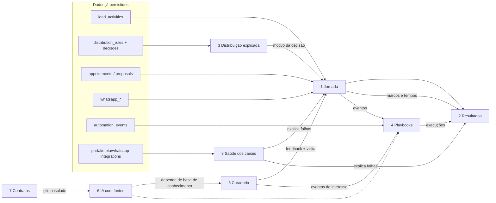

# Unitymob — Consolidação da direção de produto e da linguagem visual (v2)

Data: 13/10/2026 · Fase: **análise e planejamento** (nenhum código de produção, migration ou dependência alterado).

Legenda: **[V]** verificado no repositório · **[H]** hipótese/proposta · **[D]** depende de validação.
Os oito protótipos (`outputs/product-evolution-v2-20261013/`) usam dados fictícios; nada neles é capacidade real.

---

## 1. Diagnóstico da direção de produto

Os oito protótipos descrevem a passagem de um CRM de telas e tabelas para uma plataforma que **explica** o que aconteceu com cada lead, **mede** o resultado e **automatiza** a resposta. Isso pode ser uma só história: *atendimento mensurável*.

- **[V] Já existe a base de dados da história.** `lead_activities` (linha do tempo com `kind`, `metadata`, `source_category`), `lead_audit_logs`, `appointments`, `proposals`, `whatsapp_*`, `distribution_rules`, `automation_*` e `interest_intelligence`.
- **[V] O que falta é majoritariamente costura, não domínio novo.** Os marcos do atendimento são recalculados de `lead_activities` a cada leitura, sem colunas nem eventos de marco; o motivo da distribuição não é gravado; os cálculos do dashboard estão num controller de 2.461 linhas.
- **[V] Apenas Contratos de locação e IA com fontes são domínios novos.** Não há contrato de locação (só valores em `habitations`, `proprietors` e o papel `rentals_manager`) nem base de conhecimento/RAG (sem pgvector, embeddings ou citação de fontes).
- **[H] Cinco capacidades** (Operação, Inteligência, Automação, Conhecimento, Gestão) fazem sentido como **lente de organização do roadmap**, não como novos menus. Conhecimento e Gestão (contratos) são as que hoje têm menos base.

## 2. Matriz de avaliação das oito experiências

| # | Experiência | O que o protótipo mostra | O que já existe [V] | Lacuna real [V] | Dados | Dependências | Complexidade | Classe |
|---|---|---|---|---|---|---|---|---|
| 1 | **Jornada do atendimento** | Linha do tempo por lead, com marcos e durações | `Leads::Journey` (projeção por evidências), `_journey.html.erb`, `ax_journey_controller.js` (ECharts), `Leads::PoolTimeline` | Só calcula "tempo decorrido até agora", não duração entre marcos; critério de "contato" diverge entre Jornada (estrito) e dashboard (largo, conta `accepted`); sem `accepted_at`/`first_contact_at`/`visited_at`; `appointments` sem `completed_at` | Parcial | Definição única de marcos | Média | **Parcialmente existente** |
| 2 | **Resultados da operação** | Funil, tempos, valor | Dashboard (`sections/*`), `Dashboard::CampaignPerformanceQuery`, `Meta::CampaignFunnelQuery`, `Leads::AttentionQuery`, tempo médio de 1º contato e de resposta no WhatsApp | Só médias (sem mediana/p90/% no SLA); funil usa status atual, não histórico de etapas; sem R$ no funil; sem "trabalho manual eliminado" nem "recuperação de leads"; lógica no controller | Parcial | #1 (marcos), histórico de etapas | Média | **Parcialmente existente** |
| 3 | **Distribuição explicada** | Sankey, por que a regra venceu, simulador | `DistributionRule`, `Leads::DistributorService`, atividades `distributed`/`shark_tank_ready`/`distribution_failed`/`dammed` com `rule_id`/`rule_name` | **Motivo da escolha não é gravado** (posição na fila, peso, sorteio, sticky além de flag); inelegíveis e seus motivos somem; regras avaliadas/rejeitadas não registradas; `find_matching_rule` pega a primeira que bate, sem prioridade; **sem simulador de distribuição** (o `Automation::Simulator` é só de workflows) | Insuficiente | Instrumentar o distribuidor | Alta | **Nova (precisa de dado novo)** · [D] |
| 4 | **Playbooks imobiliários** | Modelos de fluxo reutilizáveis | Motor completo (`Automation::*`, workflows versionados, `EventCatalog`, builder) e eventos de interesse (`matching_property_found`, `interested_property_price_dropped`, `lead_idle`) | **Não há catálogo/modelos de fluxo de negócio** (só `TemplateScaffold` de template WhatsApp); sem evento de "lembrete de visita" no motor (o lembrete existe fora, em `appointments`); "lead sem contato" só aproximável por `lead_idle` | Existe (eventos) | #3/#1 para gatilhos melhores | Baixa/Média | **Parcialmente existente** (falta a camada de modelos) |
| 5 | **Curadoria e feedback** | Sugestão de imóveis e retorno do corretor | `InterestIntelligence::Matcher/ProfileBuilder`, `lead_property_interests`, `ai_property_share_*` com auditoria de cliques | **Sem feedback do corretor** (aceita/rejeita); score e motivos do match não persistidos; remover interesse apaga o rastro e a sugestão pode voltar; nada liga sugestão a visita | Insuficiente | #1 | Média | **Nova (dado novo)** · [D] |
| 6 | **IA com fontes** | Respostas com citação e fontes | `Ai::*`, `Ai::PropertySearch::*` (texto/voz → filtros → SQL), `open_ai_usage_events` (custo), config por conta | **Não há RAG**, nem embeddings, nem citação, nem avaliação de qualidade; hoje é *NL→filtro*, não conhecimento | Inexistente | Decisão de produto/custo/privacidade | Alta | **Nova** · [D] |
| 7 | **Contratos de locação** | Vencimentos, reajustes, documentos | `habitations` (valores de locação), `proprietors`, `commercial_contract_*` (**é o contrato SaaS, não locação**), Active Storage, notificações | **Nada de contrato de locação** (locatário, vigência, índice, reajuste, documentos, vínculo formal imóvel-proprietário-locatário) | Inexistente | Validação de demanda | Alta | **Novo domínio (piloto)** · [D] |
| 8 | **Preparação e saúde dos canais** | Checklist e saúde por canal | `system/health` (infra), `PortalIntegration` (mais completo: `last_feed_at`, `last_webhook_at`, `readiness_status`), `StorageIntegrationSetting` (`last_tested_at`), `test_connection` no WhatsApp/RD/Storage, `_integration_onboarding` (só na Meta) | Resultado do teste do WhatsApp/e-mail **não é persistido**; sem `last_webhook_at` no WhatsApp/Meta; sem padrão `last_success_at`/`last_checked_at`; sem tela única de prontidão por conta; nenhum job revalida expiração de token | Parcial | Padronizar colunas | Baixa/Média | **Parcialmente existente** |

## 3. Mapa de conexões funcionais

- **[V] Conexão que já existe:** `Automation::EventBus.emit` grava na timeline, e a Jornada lê a timeline; Matcher e Reprocessor já emitem eventos para o motor de automação.
- **[H] Centro de gravidade:** **Jornada + marcos** é a dependência comum de Resultados, Playbooks (gatilhos) e Curadoria (feedback → visita). Definir marcos uma vez evita três cálculos divergentes.
- **[V] Conflito a resolver:** hoje existem dois critérios de "primeiro contato" (Jornada e dashboard).
- **[V] Sobreposição:** `Automation::Simulator` e um futuro simulador de distribuição são problemas distintos; não reaproveitar o primeiro como se fosse o segundo.

## 4. Diagnóstico arquitetural

**Reutilizar [V]**
- ECharts já vendorizado e carregado dinamicamente (`ax_journey_controller.js`); `Admin::UiHelper` e `shared/ui` (`ax_metric_card`, `ax_workflow`, `ax_event_race`, `ax_journey_explorer`, `ax_board`); tokens em `admin/theme_tokens.css`; `EventBus`/`EventCatalog`; `Leads::AuditChangeRecorder`; `PortalIntegration#readiness_status` como modelo para os demais canais.

**Centralizar [H]**
- Uma definição única de marcos do atendimento (hoje espalhada entre `Leads::Journey`, `DashboardController` e `AttentionQuery`), em um objeto de domínio/consulta — não em controller.
- Extrair métricas do `DashboardController` (2.461 linhas) para queries/services **apenas nas métricas que as novas telas consumirem** (sem refatoração em massa).
- Um `ChannelReadiness` por conta lendo colunas que já existem, mais `last_checked_at`/`last_check_status` nos canais que não têm.

**Lacunas reais de dados [V]**
- Motivo da distribuição (nada gravado), feedback do corretor sobre sugestão, `completed_at` de visita, histórico estruturado de etapas do pipeline (`lead_pipeline_stage_transitions` é só o grafo de transições permitidas, não histórico), resultado de teste de conexão, entidade de contrato de locação, base de conhecimento.

**Frontend**
- Importmap sem bundler. Duas libs de gráfico convivem (Chart.js 4.4.1 em quatro controllers; ECharts na Jornada). **[H]** Padronizar novas visualizações em ECharts + CSS; Chart.js migra só por oportunidade.
- **[V]** O bloco global de `prefers-reduced-motion` não alcança ECharts/Chart.js: precisa de tratamento por JS no componente compartilhado.
- React/React Flow ficam **só** no protótipo. Não justificam nova arquitetura em produção.

## 5. Proposta de evolução visual

Princípio: **cada informação com sua própria forma**, todas sobre os mesmos tokens e o mesmo componente-base `ax_chart` (ECharts) com tema escuro, reduced-motion, estado vazio/erro e resumo textual acessível.

| Experiência | Forma principal | Interações | Cor e movimento | Mobile |
|---|---|---|---|---|
| Jornada | **Timeline com duração entre marcos** (barras proporcionais ao tempo) e destaque do gargalo | Clicar no marco abre o evento e o autor; filtro por canal | Cor por tipo de marco; o gargalo pulsa uma vez ao abrir | Timeline vertical |
| Resultados | **Funil com taxas entre etapas + heatmap hora×dia** de resposta + faixa de tendência | Período, corretor, canal; hover compara com período anterior | Escala sequencial; anomalias em destaque | Cards-resumo e um gráfico por vez |
| Distribuição | **Sankey** origem → regra → corretor/pool/contingência | Clicar num fluxo lista os leads; painel "por que esta regra" | Largura = volume; cor = destino | Lista de passos em vez de Sankey |
| Playbooks | **Fluxograma** gatilho → condição → ação, com contagem por nó | Pré-visualização do caminho; ativar a partir de modelo | Estado por nó (ativo/pausado/erro) | Lista de etapas |
| Curadoria | **Grafo lead ↔ imóvel ↔ critério** + cartões com motivo do match | Aceitar/rejeitar sugestão (grava feedback) | Aresta por força do match | Cartões |
| IA com fontes | Resposta com **chips de fonte** e painel lateral da citação | Abrir fonte; avaliar resposta | Discreto | Painel em tela cheia |
| Contratos | **Linha do tempo de vigência** + calendário de reajustes | Filtrar vencimentos | Semáforo de prazo | Lista por vencimento |
| Saúde dos canais | **Matriz canal × verificação** (configurado / testado / recebendo) | Reexecutar teste | Verde/âmbar/vermelho com data | Cartões por canal |

Acessibilidade e desempenho: todo gráfico com tabela/resumo alternativo, `aria-label`, `animation:false` sob reduced-motion, carregamento sob demanda do ECharts, e avaliação de build enxuto (tree-shaking) para reduzir o peso do bundle completo.

## 6. Roadmap priorizado

| Fase | Entrega | Tipo | Critérios de aceite |
|---|---|---|---|
| **0** | Este documento aprovado + decisões da seção 7 | Planejamento | Decisões registradas |
| **1** | Fundação `ax_chart` (ECharts compartilhado, tokens, tema escuro, reduced-motion, vazio/erro, resumo acessível); fixar e anotar versão do ECharts | Melhoria de experiência | Um gráfico de teste passa em claro/escuro/mobile; specs das telas vizinhas verdes |
| **2** | **Marcos únicos do atendimento** (definição + consulta; sem mudar a UI antiga) e Jornada com durações | Evolução funcional | Mesmo número na Jornada e no dashboard para o mesmo lead; testes dos casos de borda ("accepted" como contato) |
| **3** | **Resultados**: funil/heatmap/tendência com mediana, p90 e % no SLA, sobre os marcos da fase 2 | Evolução funcional | Valores batem com a consulta atual na média; novos gráficos em ECharts |
| **4** | **Saúde dos canais**: `ChannelReadiness` + persistir resultado dos testes (`last_checked_at`) | Evolução funcional (baixo risco) | Cada canal mostra "configurado/testado/recebendo" com data |
| **5** | **Distribuição explicada**: gravar o motivo da decisão (fila, peso, inelegíveis, regra) → Sankey; simulador só depois | Evolução + dado novo [D] | Decisões novas trazem motivo; leads antigos mostram "sem registro" (sem inventar) |
| **6** | **Playbooks**: catálogo de modelos sobre o motor existente (lead sem contato, imóvel compatível, queda de preço, lembrete de visita) | Evolução funcional | Modelo instancia fluxo editável no builder; lembrete de visita vira evento |
| **7** | **Curadoria**: feedback do corretor (aceita/rejeita) ligado a visita | Dado novo [D] | Rejeição não volta a ser sugerida |
| **8** | **IA com fontes** e **Contratos** | Novos domínios [D] | Só após validação de demanda, dados, custo e privacidade |

Ordem: **1 → 2 → 3 → 4** entregam valor visível sem dado novo; **5–7** exigem instrumentação; **8** é opcional por demanda. Cada fase deve rodar as specs das telas tocadas **e** vizinhas (dashboard, leads, builder), compilar `admin_tailwind:build` e passar checagem visual em claro/escuro/mobile.

## 7. Riscos e decisões pendentes

1. **Definição de "primeiro contato"** (estrita vs. larga). Precisa de uma só regra de negócio antes da fase 2.
2. **Dados históricos:** leads antigos não terão motivo de distribuição nem histórico de etapas; a UI deve mostrar "sem registro", nunca estimar.
3. **Instrumentar o distribuidor** (fase 5) mexe no núcleo de distribuição: exige testes de regressão fortes e gravação sem alterar a decisão nem a latência.
4. **Duas bibliotecas de gráfico:** manter Chart.js nas telas atuais ou migrar? (recomendação: migrar só por oportunidade).
5. **Peso do ECharts** completo no admin: decidir build enxuto.
6. **Privacidade/LGPD** em IA com fontes (quais documentos entram, permissão por perfil) e em qualquer exibição de telefone/e-mail em novas visualizações.
7. **Contratos de locação:** confirmar demanda real antes de modelar (tabela, anexos, vencimento, reajuste).
8. **Valor em R$ no funil:** `proposals.valor_cents` existe, mas a regra de atribuição a lead/corretor/campanha precisa ser definida.
9. **Métricas de valor** ("trabalho manual eliminado", "recuperação de leads") não existem hoje; definir o que conta antes de exibir.

**Fora de escopo desta fase:** código de produção, migrations, novas dependências, novos módulos.
